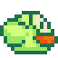
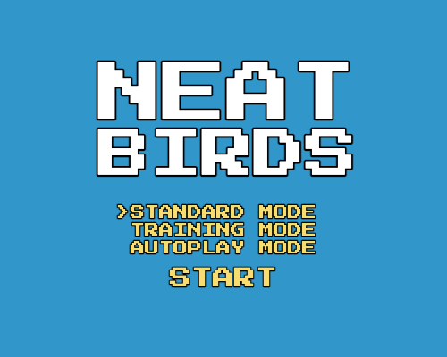
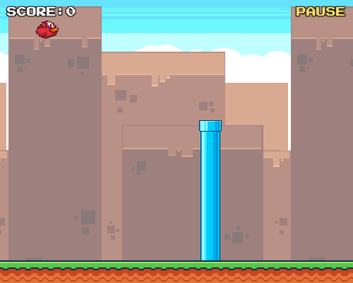
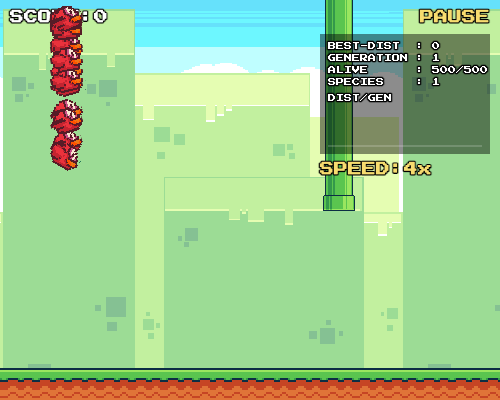

<div align="center">



# NEAT Birds

[](LICENSE) [](https://www.typescriptlang.org) [](https://developer.mozilla.org/docs/Web/API/Canvas_API)

**A Flappy Bird that evolves its own brain.**

Watch a flock of 500 birds teach _themselves_ to fly through pipes using the
**NEAT** (NeuroEvolution of Augmenting Topologies) algorithm — hand-written in
TypeScript, with zero game or machine-learning libraries.

[**Try it live**](https://kaushalmeena.github.io/neat-birds/)

</div>

---

## Screenshots

<table>
  <tr>
    <td align="center">
      <br/>
      <sub><b>Pick a mode</b> — play, train, or replay</sub>
    </td>
    <td align="center">
      <br/>
      <sub><b>Standard</b> — you vs. the pipes</sub>
    </td>
    <td align="center">
      <br/>
      <sub><b>Training</b> — 500 birds evolving live</sub>
    </td>
  </tr>
</table>

## Features

- **Three modes** — play it yourself, watch a population evolve, or replay a
  trained brain.
- **From-scratch NEAT** — genomes, speciation, fitness sharing, elitism, and
  structural mutation, all hand-written.
- **Training dashboard** — live best-distance, generation, population, and
  species counts, plus a best-distance-per-generation chart.
- **Speed multiplier** — fast-forward evolution at 1x/2x/4x/8x since rendering,
  not simulation, is the bottleneck.
- **Portable brains** — export the champion network to a JSON file and load it
  back later to watch it fly.
- **Retro presentation** — pixel-art sprites, multiple randomized backdrops, and
  chiptune sound effects synthesized with the Web Audio API.

## How It Works

Each bird is driven by a small neural network. Every frame it receives five
normalized inputs — its vertical distance from the top and bottom of the screen,
the horizontal distance to the next pipe, and the vertical distance to that
pipe's top and bottom gap edges — plus a bias node. The single output decides
whether to flap.

In **training mode** the networks evolve rather than learn by backpropagation:

1. **Start minimal.** Every bird begins with inputs wired directly to the output
   and no hidden nodes.
2. **Score by survival.** A bird's fitness is how far it travels before dying.
3. **Speciate.** Birds with structurally similar networks are grouped so new
   topologies get time to mature before competing with the whole population.
4. **Reproduce.** Fitness sharing gives each species a share of the next
   generation; the fittest birds are bred via crossover and mutation while the
   overall champion carries over unchanged (elitism).
5. **Mutate.** Offspring can have weights perturbed, new connections added, or a
   connection split by a new hidden node — so networks grow more complex only
   when it helps.

Repeat, and the birds get measurably better at threading the pipes.

## Tech Stack

| Area          | Tools                                                                                       |
| ------------- | ------------------------------------------------------------------------------------------- |
| **Language**  | [TypeScript](https://www.typescriptlang.org/) (ES modules)                                  |
| **Rendering** | [HTML5 Canvas](https://developer.mozilla.org/docs/Web/API/Canvas_API)                       |
| **Audio**     | [Web Audio API](https://developer.mozilla.org/docs/Web/API/Web_Audio_API)                   |
| **Tooling**   | [Vite](https://vite.dev/) · [ESLint](https://eslint.org/) · [Prettier](https://prettier.io) |

## Getting Started

These instructions will get you a copy of the project up and running on your
local machine for development purposes.

### Requirements

To install and run this project you need:

- [Node.js](https://nodejs.org/) v18 or newer
- [git](https://git-scm.com/downloads) (only to clone this repository)

### Installation

To set up everything on your local machine, follow these steps:

1. Clone this repo and then change directory to the `neat-birds` folder:

```bash
git clone https://github.com/kaushalmeena/neat-birds.git
cd neat-birds
```

2. Install project dependencies using npm:

```bash
npm install
```

### Running

To run the project simply run:

```bash
npm run dev
```

Your app should now be running on
[localhost:5173/neat-birds/](http://localhost:5173/neat-birds/).

### Testing

To lint, check formatting and typecheck together:

```bash
npm run check
```

## Deployment

Every push to `main` is built and deployed to GitHub Pages automatically by the
[deploy workflow](.github/workflows/deploy.yml). One-time setup: in the
repository's **Settings > Pages**, set **Source** to **GitHub Actions**.

## Credits

- Game art (birds, pipes, tiles, backgrounds) from the
  [Flappy Bird Assets](https://megacrash.itch.io/flappy-bird-assets) pack by
  **MegaCrash**, licensed under
  [CC0 1.0 Universal](https://creativecommons.org/publicdomain/zero/1.0/).
- [Press Start 2P](https://fonts.google.com/specimen/Press+Start+2P) font by
  **CodeMan38**, licensed under the
  [SIL Open Font License](https://openfontlicense.org/).

## Contributing

Contributions are welcome! If you find a bug or have a feature request, please
[open an issue](https://github.com/kaushalmeena/neat-birds/issues/new/choose)
first to discuss it. For code changes, fork the repository, create a branch,
and open a pull request.

## License

This project is licensed under the MIT License — see the [LICENSE](LICENSE)
file for details.
